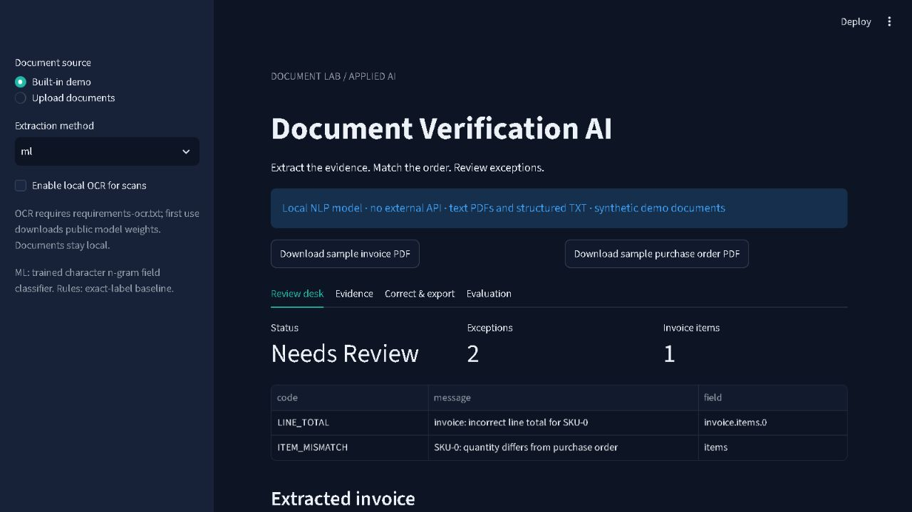
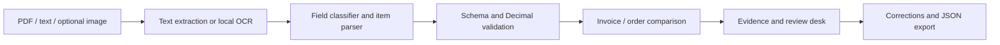

# Document Verification AI

A local document-review application that extracts invoice fields with a trainable NLP classifier, connects them to source evidence, and checks invoices against purchase orders.



## Run locally

Verified with Python 3.14:

```bash
python -m venv .venv
# Windows: .venv\Scripts\activate
# macOS/Linux: source .venv/bin/activate
pip install -r requirements.txt
python -m docverify.train
python -m pytest -q
streamlit run app.py
```

The built-in example intentionally includes an invoice quantity mismatch. The application displays the offending item, its source line and the arithmetic inconsistency. Upload your own supported PDFs/TXT files or download the sample PDFs.

```bash
uvicorn docverify.api:app --host 127.0.0.1 --port 8002
```

Open `http://127.0.0.1:8002/docs` and submit an invoice and purchase order to `POST /verify`. Documents are processed in memory and are not stored by the application. The Streamlit review screen can export a local JSON record containing the original extraction and corrected values.

## Scope: a trainable NLP system, not a general-purpose LLM

The offline model uses character n-gram TF-IDF and logistic regression to classify field labels. It does not call an external LLM or require a paid API key. Monetary and cross-document checks use deterministic Python with Decimal arithmetic. This separation makes extraction errors observable and verification reproducible.

Supported input has one labelled field per line, with `:` or `=` separators. Structured item rows use:

```text
Invoice number: INV-0042
Purchase order: PO-0042
Vendor: Demo Supplier 6
Invoice date: 2026-01-15
Currency: INR
Subtotal: 100.00
Tax: 18.00
Grand total: 118.00
ITEM | SKU-1 | Office supplies | 2 | 50.00 | 100.00
```

Arbitrary invoice tables, handwritten documents and unrestricted layouts are not supported reliably. Missing fields, low-confidence labels and duplicate fields cause review warnings rather than silent approval.

## Optional scanned-document OCR

```bash
pip install -r requirements-ocr.txt
```

Enable **local OCR for scans** in the dashboard, or use `POST /verify?enable_ocr=true`. This supports PNG/JPEG images and scanned PDFs through RapidOCR and PDFium. First use downloads public OCR model weights. The model runs locally; document contents are not sent to a provider. OCR does not remove the extraction layout constraints, and mistakes remain subject to review. See [OCR verification](reports/ocr_smoke.json) for the actual local smoke test result.

## Evaluation

Training uses three synthetic label styles; a fourth style is held out. The evaluation separately reports familiar labels and unseen wording across 80 generated documents each. This is a small **synthetic benchmark**, not evidence of real-world invoice accuracy. The unseen-style evaluation exposes a substantial generalization gap; see [results](reports/RESULTS.md) and [raw evaluation](reports/evaluation.json).

The rules baseline intentionally supports only the first label style. The ML comparison measures label generalization, not superiority over a fully engineered commercial rules system. Quantity mismatch detection is evaluated separately from header extraction. A high mismatch detection rate does not imply high document-level accuracy.

### Public real-document benchmark

The repository also includes a reproducible evaluation against [FUNSD](https://guillaumejaume.github.io/FUNSD/), a public dataset of real scanned forms and field annotations. Download FUNSD from its official site into the ignored `data/private/` folder, then run:

```bash
python -m docverify.real_benchmark --train-dir data/private/FUNSD/dataset/training_data/annotations --test-dir data/private/FUNSD/dataset/testing_data/annotations
```

This evaluates classification of the dataset's `question`, `answer`, `header`, and `other` roles using a held-out real-document split. FUNSD does **not** contain paired invoices and purchase orders or dependable invoice-total fields, so its result is reported separately in `reports/funsd_evaluation.json`; it must not be presented as invoice verification accuracy.



## Checks and tests

Checks cover required fields, duplicate SKUs, item arithmetic, subtotal/tax/total consistency, vendor/currency/order reference mismatches, missing items and quantity/price differences. Tests cover malformed input, evidence, duplicated fields, monetary validation, PDF parsing and API uploads.

`checks_passed` means those checks passed. It does not establish authenticity, confirm receipt of goods, validate tax treatment or authorize payment. Corrections are exported as a review record; there is no multi-user approval workflow or persistent audit database.

## Deployment

```bash
docker build -t document-verification .
docker run --rm -p 8502:8501 document-verification
```

The default image contains text extraction and NLP only. Optional OCR requires its extra dependencies and initial weight download. Add authentication, PDF processing isolation and operational resource limits before exposing the API publicly. Untrusted serialized model files must never be loaded.

Created with AI coding assistance. Training examples and PDFs are synthetic and contain no customer documents. Code and generated samples are MIT licensed; third-party OCR weights retain their upstream licence.
